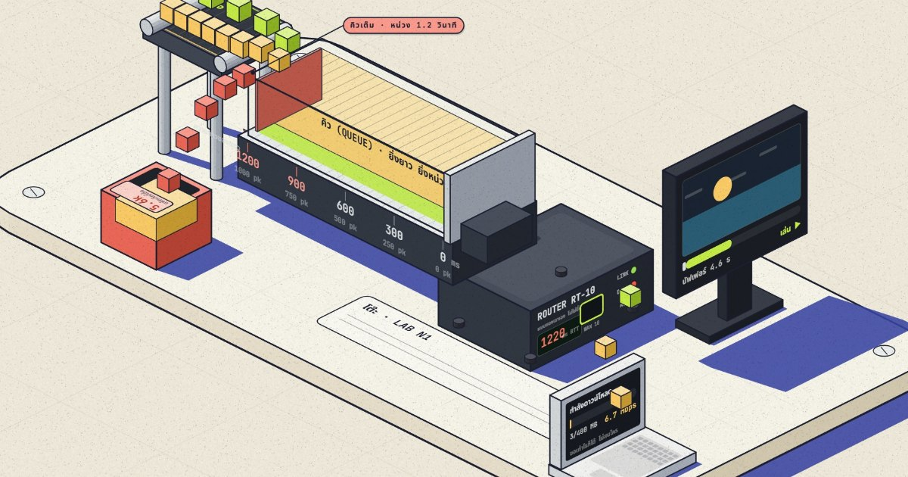

# SimpleNetworkLab

**▶ เปิดเล่นเลย → https://thtpk.github.io/SimpleNetworkLab/**

แล็บเครือข่ายแบบอินเทอร์แอคทีฟ สร้างด้วย [SIMULAB](https://github.com/0xKapri) — หน้าเว็บไอโซเมตริกไฟล์เดียวที่เปิดออฟไลน์ได้ พร้อมวิดีโอ 60 fps

An interactive isometric network lab: one offline HTML file plus a 60 fps video with sound.

---

## Lab N1 · ทำไมวิดีโอกระตุกตอนมีคนโหลดไฟล์?

> *Why does your video stutter when someone else starts a download?*



| | |
|---|---|
| **หน้าแล็บ** | [`index.html`](index.html) — 543 KB ไฟล์เดียวจบ เปิดออฟไลน์ ไม่ต้องต่อเน็ต · เสิร์ฟอยู่ที่ [thtpk.github.io/SimpleNetworkLab](https://thtpk.github.io/SimpleNetworkLab/) |
| **วิดีโอ** | [`labs/labN1-cola/render/labN1-cola.mp4`](labs/labN1-cola/render/labN1-cola.mp4) — 1500×1200 · 60 fps · 39.7 s · −14.5 LUFS |
| **ที่มาของภาพ** | `model.js` (แบบจำลองล้วน) · `demo.js` (ฉาก บท พาเนล) · `demo.json` (ชื่อเรื่อง + ที่มาของตัวเลข) |

### คำตอบสั้น ๆ

**ไม่ใช่เน็ตช้า — คิวในเราเตอร์ยาวเกินไป**

ลิงก์เข้าบ้าน 10 Mbps เป็นคอขวดเดียว วิดีโอ 1080p ขอ 5 Mbps พออีกเครื่องขอ 20 Mbps
เข้ามาในลิงก์เดิม ของที่ส่งออกไม่ทันก็ไปกองในบัฟเฟอร์ของอุปกรณ์ปลายลิงก์ ที่นี่แล็บวาดคิวเป็น
"แถว" ในช่องแก้วยาว มีไม้บรรทัดบอกทั้ง **ms** และ **จำนวนแพ็กเก็ต** ตามความยาวของแถว

### สามบท

| บท | สถานการณ์ | คิว | RTT | ผล |
|---|---|---|---|---|
| 1 | ไม่มีใครโหลด | 0 แพ็กเก็ต | 20 ms | ลื่น |
| 2 | โหลด 20 Mbps · AQM ปิด | เต็ม 1000 แพ็กเก็ต | **1220 ms** | บัฟเฟอร์วิดีโอหมด → **กระตุก** |
| 3 | โหลด 20 Mbps · **AQM เปิด** | 4 แพ็กเก็ต | 25 ms | วิดีโอกลับมาเล่นได้ |

บทที่ 3 คือหัวใจ: **แบนด์วิดท์ไม่เพิ่มขึ้นเลยสักนิด** สิ่งที่เปลี่ยนคือความยาวของคิวอย่างเดียว

### ลองเอง

กดปุ่ม **▶ ลองเอง** บนหน้าแล็บ แล้ว:

- หมุนลูกบิด **ดาวน์โหลด** 0–30 Mbps
- กด **D** ค้าง = เริ่มโหลดไฟล์
- กด **A** ค้าง = เปิด AQM (fq_codel)

คิว บัฟเฟอร์วิดีโอ แพ็กเก็ตที่ถูกทิ้ง และคำตัดสินจะขยับตามจริงทุกเฟรม
พร้อมช่องเทียบกับผลของทั้งสามบท

---

## ตัวเลขมาจากไหน

ทุกอย่างบนจอมาจากแบบจำลองเดียวใน [`model.js`](labs/labN1-cola/model.js) ไม่มีเลขที่เขียนทับมือ

| ค่า | ที่มา |
|---|---|
| วิดีโอ 1080p ต้องการ 5 Mbps ขึ้นไป (4K 15 Mbps) | [Netflix · Internet connection speed recommendations](https://help.netflix.com/en/node/306) |
| IP datagram ใหญ่สุดบน Ethernet = 1500 ไบต์ | [RFC 894](https://www.rfc-editor.org/rfc/rfc894.html) |
| CoDel TARGET 5 ms · INTERVAL 100 ms (TARGET = 5% ของ INTERVAL) | [RFC 8289 §4.2, §4.3, §4.5](https://www.rfc-editor.org/rfc/rfc8289.html) |
| หน่วงระดับ 1.2 วินาทีตอนลิงก์ทำงานเต็มที่ และ AQM คือทางแก้ | Gettys & Nichols, *Bufferbloat: Dark Buffers in the Internet*, [ACM Queue 2011](https://queue.acm.org/detail.cfm?id=2071893) |

### การตรวจด้วยมือ

บัฟเฟอร์ 1000 แพ็กเก็ต (ค่า `txqueuelen` ปริยายของ Linux):

```
1000 pk × 1500 B × 8 = 12 Mb
12 Mb ÷ 10 Mbps      = 1.2 วินาที
```

ซึ่งตรงกับ **1.2 วินาที** ที่ Gettys วัดได้จริงและรายงานไว้ใน ACM Queue

สมมติฐานที่เหลือ (ลิงก์ 10 Mbps เป็นคอขวดเดียว, RTT พื้นฐาน 20 ms, ตัวเล่นกันบัฟเฟอร์ 6 วินาที,
FIFO แบ่งแบนด์วิดท์ตามสัดส่วนที่ส่งเข้ามา ส่วน fq_codel แบ่งแบบ max-min fair ฯลฯ)
เขียนกำกับไว้ครบใน `demo.json` และพิมพ์อยู่ใต้หน้าแล็บ

---

## สร้างใหม่

ต้องมี [SIMULAB](https://github.com/0xKapri) ติดตั้งไว้ที่ `~/.claude/skills/simulab` ก่อน
แล้วลง `skill-patches/` ตาม [`skill-patches/README.md`](skill-patches/README.md)
(ชุด asset เครือข่าย + ฟอนต์ไทย — ถ้าไม่ลง หน้าแล็บจะไม่มีอุปกรณ์และข้อความไทยจะไม่ขึ้น)

```bash
./build.sh                                           # -> index.html ที่ราก (หน้าที่ Pages เสิร์ฟ)

SD=~/.claude/skills/simulab
node "$SD/tools/stills.mjs" labs/labN1-cola --w=620 --cols=3 3 9 17 23 27 37
bash  "$SD/tools/video.sh"  labs/labN1-cola labN1-cola --preview
bash  "$SD/tools/video.sh"  labs/labN1-cola labN1-cola
node  "$SD/tools/cover.mjs" labs/labN1-cola
```

`index.html` ที่รากคือผลลัพธ์ของ `build.sh` (ซึ่งก็อปมาจาก `labs/labN1-cola/dist/index.html`)
ส่วน `labs/*/dist/` ไม่ได้เก็บใน git เพราะ build ใหม่ได้เสมอ — แก้ซอร์สแล้วรัน `./build.sh` ทุกครั้งก่อน commit

### เผยแพร่

เสิร์ฟด้วย GitHub Pages จาก branch `main` โฟลเดอร์ `/ (root)` — เปิด URL แล้วขึ้นหน้าแบบจำลองทันที
ไม่มีหน้าคั่น `.nojekyll` อยู่ที่รากเพื่อไม่ให้ Jekyll เข้ามายุ่งกับไฟล์

---

## เครดิต

Engine, assets และ tools จาก **KAPRI LAB** โดย [@0xKapri](https://x.com/0xKapri) — MIT
ฟอนต์ JetBrains Mono, Silkscreen, Caveat และ Noto Sans Thai อยู่ภายใต้ SIL Open Font License
อุปกรณ์ทุกชิ้นในภาพเป็นแบบที่ออกแบบเอง ไม่ใช่ยี่ห้อจริง
